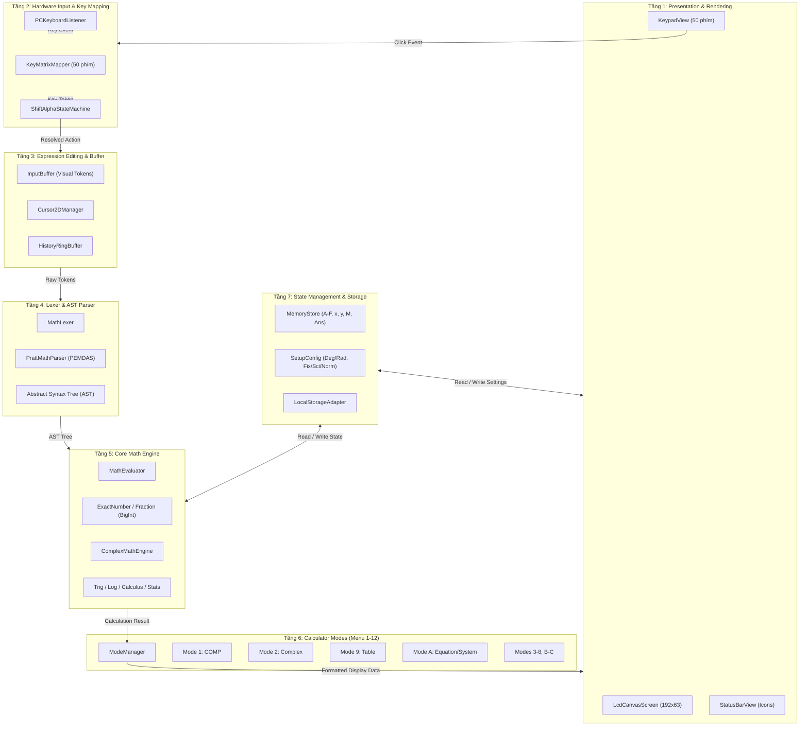

# Thiết Kế Kiến Trúc Web App Casio fx-580VN X

**Mã tài liệu:** `docs/architecture.md`  
**Dự án:** Ứng dụng Web Giả Lập / Mô Phỏng Máy Tính Khoa Học Casio fx-580VN X  
**Ngày lập:** 24/10/2026 (Nhiệm vụ T06)  
**Căn cứ thiết kế:**
- `docs/feature_inventory.md` (Danh mục toàn bộ chức năng P0/P1/P2)
- `docs/reverse_engineering/classwiz_hardware_interface.md` (Bố cục 50 phím, ma trận hardware, tọa độ LCD)
- `docs/reverse_engineering/simu8_cpu_core.md` & `docs/reverse_engineering/memory_and_bus_architecture.md` (Quy chuẩn hoạt động ALU, bộ nhớ và VRAM)

---

## 1. Đánh Giá Hiện Trạng và Lựa Chọn Công Nghệ (Tech Stack)

### 1.1. Hiện trạng môi trường phát triển
- **Hệ điều hành:** macOS (ARM64).
- **Runtime:** Node.js `v26.7.0`, npm `11.19.0`, npx khả dụng.
- **Tính chất ứng dụng:** Client-Side Single Page Application (SPA), chạy 100% độc lập ngoại tuyến trên trình duyệt (Offline-First / Zero Backend), không cần máy chủ tính toán để đảm bảo tốc độ phản hồi tức thì và bảo mật tuyệt đối cho người dùng.

### 1.2. Quyết định lựa chọn công nghệ

| Thành Phần | Công Nghệ Lựa Chọn | Căn Cứ & Lý Do Lựa Chọn |
| :--- | :--- | :--- |
| **Ngôn ngữ** | **TypeScript 5.x** | Đảm bảo tính an toàn kiểu dữ liệu (Strict Typing) cho cây cú pháp AST, kiểu số chính xác cao, số phức, ma trận và các trạng thái chuyển phím (`SHIFT`, `ALPHA`). |
| **Công cụ Build & Dev** | **Vite** | Tốc độ khởi động và Hot Module Replacement (HMR) cực nhanh, tối ưu hóa bundle tĩnh, hỗ trợ TypeScript tự nhiên không cần cấu hình phức tạp. |
| **Màn hình hiển thị LCD** | **HTML5 Canvas 2D** | Màn hình fx-580VN X là ma trận điểm **192 × 63 dots**. Canvas 2D cho phép vẽ từng pixel sắc nét với thuộc tính `image-rendering: pixelated`, tái hiện hoàn hảo bộ đệm VRAM `0xF800` và các icon thông báo (`SHIFT, ALPHA, D/R/G, Math`). |
| **Bàn phím & Vỏ máy** | **HTML5 + CSS Grid / Flexbox** | Bố trí chính xác 50 phím theo tỷ lệ thực tế từ `classwiz_p20.dll`, dễ dàng responsive trên cả màn hình Desktop và Mobile, hỗ trợ cảm ứng đa điểm mượt mà. |
| **Bộ máy tính toán số học** | **Tự xây dựng + Decimal.js / BigInt** | JavaScript sử dụng số thực IEEE 754 64-bit thường gây lỗi sai số (`0.1 + 0.2 = 0.30000000000000004`). Cần kết hợp: (1) `BigInt` cho phân số chính xác tuyệt đối $\frac{a}{b}$; (2) `Decimal` với độ chính xác cố định 15 chữ số có nghĩa cho các hàm mũ/log/lượng giác. |
| **Khung kiểm thử tự động** | **Vitest** | Tích hợp liền mạch với Vite, thực thi test siêu tốc, hỗ trợ Unit Test, AST Snapshot Test và Test giả lập chuỗi bấm phím. |

---

## 2. Sơ Đồ Kiến Trúc Phân Tầng (Layered Modular Architecture)

Ứng dụng được thiết kế theo nguyên lý **Phân tách trách nhiệm (Separation of Concerns)** thành 7 tầng độc lập:



---

## 3. Thiết Kế Chi Tiết Từng Module & API Nội Bộ

### 3.1. Module Tầng 1 & 2: Giao Diện và Xử Lý Nhập Liệu

#### `ILcdRenderer` (Vẽ màn hình ma trận điểm):
```typescript
export interface ILcdRenderer {
  /** Xóa toàn bộ màn hình hoặc đưa về trạng thái rỗng */
  clear(): void;
  
  /** Kết xuất biểu thức đang nhập cùng vị trí con trỏ nhấp nháy */
  renderExpression(tokens: VisualToken[], cursorIndex: number): void;
  
  /** Kết xuất kết quả tính toán căn lề phải */
  renderResult(result: FormattedResult): void;
  
  /** Cập nhật dải biểu tượng trạng thái */
  updateIndicators(flags: StatusFlags): void;
  
  /** Hiển thị hộp thoại Menu hoặc thông báo lỗi (Math ERROR, Syntax ERROR) */
  renderModal(title: string, message: string): void;
}

export interface StatusFlags {
  shift: boolean;      // Icon 'S'
  alpha: boolean;      // Icon 'A'
  angleUnit: 'D' | 'R' | 'G'; // Đơn vị góc
  fix: boolean;        // Icon 'FIX'
  sci: boolean;        // Icon 'SCI'
  math: boolean;       // Icon 'Math' (Hiển thị 2D tự nhiên)
  hasMemory: boolean;  // Icon 'M'
  scrollUp: boolean;   // Mũi tên lên (có lịch sử trước)
  scrollDown: boolean; // Mũi tên xuống
}
```

#### `IKeypadController` & `ShiftAlphaStateMachine`:
- **Chức năng:** Quản lý phím bấm vật lý và trạng thái phím đổi (`NORMAL`, `SHIFT`, `ALPHA`).
```typescript
export type ModifierState = 'NORMAL' | 'SHIFT' | 'ALPHA';

export interface IKeypadController {
  pressKey(keyCode: string): KeyActionResult;
  getModifierState(): ModifierState;
  resetModifier(): void;
}
```
*Quy tắc chuyển trạng thái:*
- Nhấn `SHIFT`: Nếu đang `NORMAL` $\rightarrow$ chuyển sang `SHIFT` (hiện icon `S`). Nếu đang `SHIFT` $\rightarrow$ hủy về `NORMAL`.
- Nhấn `ALPHA`: Nếu đang `NORMAL` $\rightarrow$ chuyển sang `ALPHA` (hiện icon `A`). Nếu đang `ALPHA` $\rightarrow$ hủy về `NORMAL`.
- Sau khi bấm bất kỳ phím tính năng nào trong trạng thái `SHIFT` hoặc `ALPHA` $\rightarrow$ tự động trả về `NORMAL`.

---

### 3.2. Module Tầng 3 & 4: Chỉnh Sửa Biểu Thức & AST Parser

#### `VisualToken` & Biểu diễn cây cú pháp trừu tượng (AST):
Biểu thức được nhập liệu dưới dạng các khối 2D (Block-based AST):

```typescript
export type ASTNode =
  | NumberNode        // Ví dụ: 123.45
  | VariableNode      // Ví dụ: A, B, x, y, M, Ans
  | BinaryOpNode      // Ví dụ: a + b, a × b, a - b, a ÷ b
  | UnaryOpNode       // Ví dụ: -x, sin(x), cos(x), ln(x)
  | FractionNode      // Phân số: numerator (ASTNode) / denominator (ASTNode)
  | SqrtNode          // Căn: degree (ASTNode, mặc định 2), radicand (ASTNode)
  | PowerNode         // Lũy thừa: base (ASTNode) ^ exponent (ASTNode)
  | IntegralNode      // Tích phân: expr, lowerLimit, upperLimit
  | DerivativeNode    // Đạo hàm: expr, evalPoint
  | SummationNode     // Tổng Sigma: expr, var, start, end
  | ParenthesisNode;  // ( expr )
```

#### `IParser`:
- Sử dụng thuật toán **Pratt Parser (Top-Down Operator Precedence)**:
```typescript
export interface IParser {
  /** Chuyển danh sách token nhập từ bàn phím thành cây AST */
  parse(tokens: VisualToken[]): ASTNode;
}
```
*Bảng độ ưu tiên toán tử (Binding Power) chuẩn Casio ClassWiz:*
1. Dấu ngoặc đơn, khối phân số, khối căn thức (Cao nhất).
2. Hàm một ngôi hậu tố: Giai thừa `!`, Bình phương `^2`, Nghịch đảo `^-1`, Độ-phút-giây.
3. Lũy thừa `^` (kết hợp phải: $2^{3^2} = 2^{(3^2)} = 512$).
4. Hàm một ngôi tiền tố: `-` âm, `sin`, `cos`, `tan`, `ln`, `log`.
5. Phép nhân ngầm định (Implicit Multiplication, ví dụ: $2\pi$, $3(4+5)$, $2\sqrt{3}$ có độ ưu tiên cao hơn phép nhân thông thường).
6. Phép nhân `×`, phép chia `÷`.
7. Phép cộng `+`, phép trừ `-`.

---

### 3.3. Module Tầng 5: Core Math Engine (Tính Toán Chính Xác)

#### Cấu trúc dữ liệu số chính xác (`ExactNumber`):
Để hỗ trợ hiển thị tự nhiên (phân số tối giản, căn thức rút gọn) và chuyển đổi bằng phím `[S<>D]`, kết quả tính toán lưu trữ cả hai dạng:

```typescript
export class Fraction {
  readonly num: bigint; // Tử số
  readonly den: bigint; // Mẫu số (luôn dương, tối giản với num qua GCD)
  
  constructor(numerator: bigint, denominator: bigint) { ... }
  add(other: Fraction): Fraction { ... }
  sub(other: Fraction): Fraction { ... }
  mul(other: Fraction): Fraction { ... }
  div(other: Fraction): Fraction { ... }
  toDecimal(): Decimal { ... }
}

export interface CalculationResult {
  /** Biểu diễn dạng toán học tự nhiên (phân số, căn thức nếu có thể) */
  exactForm?: {
    fraction?: Fraction;
    radical?: { coefficient: Fraction; radicand: bigint }; // dạng a√b
    symbolicPi?: Fraction; // dạng a/b * π
  };
  
  /** Giá trị thập phân chính xác cao (15 chữ số có nghĩa) */
  decimalValue: Decimal;
  
  /** Trạng thái hiển thị hiện tại (phân số hay thập phân - đổi bởi S<>D) */
  currentView: 'EXACT' | 'DECIMAL';
}
```

#### `IMathEngine`:
```typescript
export interface IMathEngine {
  /** Tính toán giá trị của cây cú pháp AST trong ngữ cảnh hiện tại */
  evaluate(ast: ASTNode, context: ExecutionContext): CalculationResult;
}

export interface ExecutionContext {
  angleUnit: 'DEG' | 'RAD' | 'GRA';
  variables: Map<string, CalculationResult>; // A-F, x, y, M, Ans
  complexEnabled: boolean;
}
```

---

### 3.4. Module Tầng 6 & 7: Các Chế Độ Máy Tính & Quản Lý Trạng Thái

#### `ModeManager` & `ICalculatorMode`:
```typescript
export interface ICalculatorMode {
  readonly modeId: number;
  readonly modeName: string;
  onEnter(): void;
  onKeyPress(key: KeyAction): ModeResponse;
  getDisplayData(): DisplayData;
}
```
*Các mode triển khai theo lộ trình:*
- **Mode 1 (COMP):** Chế độ tính toán đại số mặc định.
- **Mode 2 (COMPLEX):** Chế độ số phức $a+bi$ và $r\angle\theta$.
- **Mode 9 (TABLE):** Lập bảng giá trị hàm số $f(x)$ và $g(x)$.
- **Mode A (EQUATION):** Giải hệ phương trình tuyến tính 2-4 ẩn và phương trình đa thức bậc 2-4.

#### `StateStore` (Lưu trữ trạng thái):
- Quản lý 9 biến nhớ: `A, B, C, D, E, F, x, y, M` và biến `Ans`.
- Lưu trữ cấu hình cài đặt (`SetupConfig`).
- Đồng bộ tự động vào `localStorage` qua khóa `casio_fx580vnx_state_v1`.

---

## 4. Xử Lý Lỗi (Error Handling Strategy)

Các lỗi máy tính được bắt gọn gàng ở tầng Math Engine và Parser, không làm crash ứng dụng web:

| Mã Lỗi | Nguyên Nhân Gây Lỗi | Xử Lý & Điều Hướng Người Dùng |
| :--- | :--- | :--- |
| **`Math ERROR`** | - Chia cho số 0 (`1 ÷ 0`).<br>- $\tan(90^\circ)$, $\log(0)$, $\log(-5)$, $\sqrt{-4}$ ở Mode 1.<br>- Kết quả vượt quá giới hạn $10^{100}$. | Hiện màn hình báo `[Math ERROR]`. Bấm phím `[Left]` hoặc `[Right]` đưa con trỏ về đúng vị trí phép toán gây lỗi. Bấm `[AC]` để xóa. |
| **`Syntax ERROR`** | - Hai dấu phép tính liền kề (`2 + × 3`).<br>- Dấu ngoặc mở không đóng.<br>- Biểu thức rỗng hoặc kết thúc bằng toán tử nhị phân. | Hiện `[Syntax ERROR]`. Bấm mũi tên đưa con trỏ về vị trí sai cú pháp. |
| **`Dimension ERROR`** | - Phép toán ma trận sai kích thước (nhân $2\times 3$ với $2\times 3$). | Hiện `[Dimension ERROR]`. |
| **`Stack ERROR`** | - Số lượng ngoặc đơn lồng nhau vượt quá 24 mức. | Hiện `[Stack ERROR]`. |

---

## 5. Các Hành Vi Chưa Rõ (TODOs & Safe Fallbacks)

Để tuân thủ nguyên tắc không suy diễn ngoài bằng chứng thực tế, các thành phần sau sẽ được gắn thẻ `TODO` kèm cơ chế dự phòng an toàn (Safe Fallback):

1. **`TODO-ERR-01` (Chi tiết mã lỗi hệ phương trình suy biến):** Khi hệ phương trình vô số nghiệm hoặc vô nghiệm, máy Casio ClassWiz hiển thị "Infinite Solutions" hoặc "No Solution". *Fallback:* Hiển thị thông báo tiếng Anh/Việt tương ứng, không crash.
2. **`TODO-ALG-02` (Rút gọn căn thức bậc cao):** Hiện tại đã xác minh rút gọn căn bậc hai dạng $a\sqrt{b}$. Đối với căn bậc 3, 4 phức tạp có chứa phân số bên trong: *Fallback:* Hiển thị dạng căn chuẩn hoặc chuyển sang số thập phân nếu căn thức không tối giản được.
3. **`TODO-ROM-03` (Hằng số khoa học & Chuyển đổi đơn vị):** Bộ hằng số khoa học trong menu `CONST` sẽ được bổ sung theo bảng chuẩn CODATA nếu chưa trích xuất đủ từ firmware.

---

## 6. Chiến Lược Kiểm Thử Tự Động (Automated Testing Strategy)

```
        ┌────────────────────────────────────────────────────────┐
        │       E2E KEY SEQUENCE TESTS (Chuỗi gõ phím)          │
        │       Giả lập người dùng bấm phím trên bàn phím ảo     │
        ├────────────────────────────────────────────────────────┤
        │       GOLDEN VERIFICATION TESTS (Đối chiếu Casio)      │
        │       100+ bài toán mẫu từ đề thi THPT Quốc Gia        │
        ├────────────────────────────────────────────────────────┤
        │       UNIT TESTS (Engine, Parser, AST, Fraction)       │
        │       Toán tử PEMDAS, BigInt GCD, Complex Math         │
        └────────────────────────────────────────────────────────┘
```

1. **Unit Test Bộ Máy Tính Toán (`MathEngine.test.ts`):**
   - Kiểm thử 4 phép tính cơ bản, thứ tự ưu tiên PEMDAS.
   - Kiểm thử số học phân số: $\frac{1}{2} + \frac{1}{3} = \frac{5}{6}$, tối giản $\frac{12}{18} \rightarrow \frac{2}{3}$.
   - Kiểm thử số phức: $(1+2i)^2 = -3 + 4i$.
   - Kiểm thử đơn vị góc: $\sin(30^\circ) = 0.5$ (Deg) vs $\sin(\pi/6) = 0.5$ (Rad).
2. **Golden Verification Test Suite (`GoldenCasio.test.ts`):**
   - Bộ dữ liệu gồm 100 biểu thức toán thực tế của học sinh THPT (giải phương trình bậc 3, đạo hàm tại điểm, tích phân lượng giác, ma trận nghịch đảo).
   - So sánh kết quả đầu ra với kết quả chuẩn quan sát được từ phần mềm gốc.
3. **Key Sequence End-to-End Tests (`KeySequence.test.ts`):**
   - Giả lập chuỗi gõ phím tuần tự:
     `['1', '/', '2', '+', '1', '/', '3', '=']` $\rightarrow$ Kiểm tra màn hình Canvas hiển thị $\frac{5}{6}$.
     Bấm tiếp `['S<>D']` $\rightarrow$ Kiểm tra màn hình chuyển sang `0.8333333333`.

---

## 7. Thiết Kế Responsive & Trải Nghiệm Desktop / Mobile

- **Giao diện Desktop:**
  - Hiển thị đầy đủ thân máy tính fx-580VN X đặt giữa màn hình với tỷ lệ khung hình chuẩn $1:2.1$.
  - Màn hình LCD phóng to sắc nét, hỗ trợ gõ phím vật lý từ bàn phím máy tính PC (theo đúng bảng mapping từ `classwiz_p20.dll`).
- **Giao diện Mobile (Điện thoại / Tablet):**
  - Tự động co giãn theo chiều rộng màn hình (viewport width), tối ưu hóa không gian hiển thị.
  - Kích thước vùng bấm cảm ứng (Touch Target) của mỗi phím tối thiểu đạt **$44 \times 44$ pixels** theo tiêu chuẩn tiếp cận Web Accessibility (WCAG 2.1).
  - Khóa thao tác double-tap zoom của trình duyệt di động bằng CSS `touch-action: manipulation`.
  - Hiệu ứng phản hồi rung nhẹ (Haptic Feedback qua `navigator.vibrate(10)`) khi bấm phím trên điện thoại hỗ trợ.
