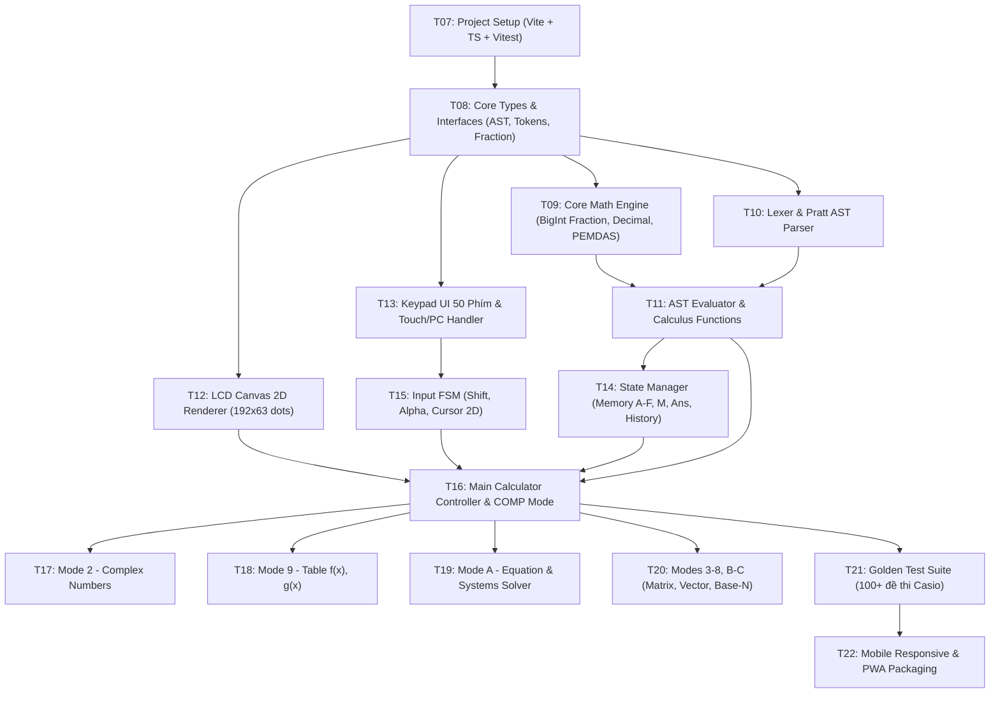

# Kế Hoạch Triển Khai Web App Casio fx-580VN X (Implementation Plan)

**Dự án:** Ứng dụng Web Giả Lập Casio fx-580VN X  
**Cập nhật lần cuối:** 24/10/2026 (Nhiệm vụ T06)  
**Tài liệu liên quan:**
- [docs/architecture.md](file:///Users/nam/rea_casio580vnx/docs/architecture.md) (Thiết kế kiến trúc hệ thống)
- [docs/feature_inventory.md](file:///Users/nam/rea_casio580vnx/docs/feature_inventory.md) (Danh mục toàn diện chức năng P0/P1/P2)
- [docs/progress.md](file:///Users/nam/rea_casio580vnx/docs/progress.md) (Theo dõi tiến độ dự án)

---

## 1. Sơ Đồ Phụ Thuộc Giữa Các Module (Dependency Graph)

---

## 2. Lộ Trình Triển Khai Chi Tiết Theo Từng Giai Đoạn

### Giai Đoạn 1: Thiết Lập Nền Tảng & Lõi Tính Toán Cơ Bản (Phase 1 - Core MVP)
*Mục tiêu:* Xây dựng ứng dụng hoàn chỉnh có thể bấm 50 phím, nhập và hiển thị biểu thức tự nhiên, tính đúng 4 phép toán, phân số, căn số, số mũ và lưu biến `Ans`.

| Mã Task | Tên Nhiệm Vụ | Nội Dung & Tiêu Chí Nghiệm Thu (Acceptance Criteria) | Module Phụ Thuộc |
| :--- | :--- | :--- | :--- |
| **T07** | **Project Setup** | - Khởi tạo project với Vite + TypeScript + Vitest. - Cấu hình strict mode trong `tsconfig.json`. - Thiết lập cấu trúc thư mục `src/core/`, `src/ui/`, `src/modes/`, `tests/`. | Không |
| **T08** | **Core Types & Tokens** | - Định nghĩa `VisualToken`, `ASTNode`, `ModifierState`, `StatusFlags`. - Định nghĩa bảng 50 mã phím ClassWiz và ma trận hardware từ `classwiz_p20.dll`. | T07 |
| **T09** | **Fraction & Exact Math** | - Hiện thực lớp `Fraction` (BigInt tử/mẫu, GCD tối giản). - Hiện thực lớp `ExactNumber` kết hợp giữa `Fraction` và `Decimal.js` (15 chữ số có nghĩa). - Unit tests: Cộng, trừ, nhân, chia phân số chính xác 100%. | T08 |
| **T10** | **Lexer & Pratt Parser** | - Hiện thực `MathLexer` chuyển chuỗi phím bấm thành token stream. - Hiện thực `PrattMathParser` xử lý thứ tự ưu tiên PEMDAS và nhân ngầm định. - Xử lý chuẩn xác các cấu trúc 2D lồng nhau (phân số, căn, lũy thừa). | T08 |
| **T11** | **AST Evaluator** | - Duyệt cây AST và tính toán kết quả số học. - Tự động phát hiện lỗi `Math ERROR` (chia 0, log âm) và `Syntax ERROR`. - Lưu trữ kết quả dạng `exactForm` (phân số tối giản) và `decimalValue`. | T09, T10 |
| **T12** | **LCD Canvas Renderer** | - Hiện thực Canvas 2D độ phân giải ma trận 192 × 63 dots. - Font ma trận chấm tùy biến hiển thị số, biểu thức phân số 2D và con trỏ nhấp nháy. - Hiển thị dải icon trạng thái (`S, A, D/R/G, Math, M`). | T08 |
| **T13** | **Keypad UI & PC Input** | - Render giao diện 50 phím bấm chuẩn ClassWiz bằng CSS Grid. - Bắt sự kiện phím gõ từ bàn phím máy tính PC (theo bảng phím tắt `classwiz_p20.dll`). - Hiệu ứng active/press và rung cảm ứng (Haptic Feedback) trên điện thoại. | T08 |
| **T14** | **State & Memory Store** | - Quản lý 9 biến nhớ (`A-F, x, y, M`) và bộ nhớ `Ans`. - Thao tác gán `STO` và đọc `ALPHA`. - Ring buffer lưu trữ lịch sử tính toán (tối thiểu 30 phép tính). | T09 |
| **T15** | **Input FSM & Cursor 2D** | - Máy trạng thái chuyển đổi phím `NORMAL`, `SHIFT`, `ALPHA`. - Quản lý con trỏ 2D di chuyển vào/ra khối phân số, số mũ, căn thức. - Chức năng xóa `[DEL]` và xóa trắng `[AC]`. | T08, T13 |
| **T16** | **Calculator Controller** | - Tích hợp toàn bộ T07-T15 thành ứng dụng chạy hoàn chỉnh (Mode 1 COMP). - Nối phím `[S<>D]` chuyển đổi tức thì giữa Phân số và Thập phân. - Tự động nối `Ans` khi bấm dấu phép tính sau khi có kết quả. | T11, T12, T14, T15 |

---

### Giai Đoạn 2: Hàm Toán Học Nâng Cao & Các Mode Trọng Điểm (Phase 2 - Scientific Core)
*Mục tiêu:* Hỗ trợ toàn bộ các hàm giải tích chuyên sâu, đơn vị góc Deg/Rad/Gra, Mode Số phức, Mode Bảng giá trị và Mode Giải phương trình.

| Mã Task | Tên Nhiệm Vụ | Nội Dung & Tiêu Chí Nghiệm Thu (Acceptance Criteria) | Module Phụ Thuộc |
| :--- | :--- | :--- | :--- |
| **T17** | **Scientific Functions** | - Hàm lượng giác $\sin, \cos, \tan$ và lượng giác ngược theo 3 đơn vị góc `D, R, G`. - Logarit tự nhiên $\ln$ và logarit cơ số bất kỳ $\log_a(b)$. - Giai thừa $n!$, Tổ hợp $n\text{C}r$, Chỉnh hợp $n\text{P}r$, Phân tích thừa số nguyên tố `FACT`. - Đạo hàm số $\left.\frac{d}{dx}\right|_{x=a}$ và Tích phân số $\int_a^b$ (Gauss-Kronrod). | T16 |
| **T18** | **Mode 2: Complex Numbers** | - Lớp số phức `ComplexNumber` ($a+bi$ và $r\angle\theta$). - Cộng, trừ, nhân, chia số phức, lũy thừa số phức. - Tính Module $\text{Abs}(z)$, Argument $\text{Arg}(z)$, Số phức liên hợp $\text{Conjg}(z)$. | T17 |
| **T19** | **Mode 9: Table of Values** | - Nhập đồng thời 2 hàm số $f(x)$ và $g(x)$. - Nhập phạm vi bảng: Start, End, Step. - Hiển thị bảng giá trị 3 cột ($x, f(x), g(x)$) cuộn dòng mượt mà. | T17 |
| **T20** | **Mode A: Equation Solver** | - Giải hệ phương trình tuyến tính 2, 3, 4 ẩn (khử Gauss-Jordan). - Giải phương trình đa thức bậc 2, 3, 4 (nghiệm thực, nghiệm phức). - Tìm tọa độ đỉnh/cực trị của parabol ($x_{min}, y_{min}$ hoặc $x_{max}, y_{max}$) ở phương trình bậc 2. | T18 |

---

### Giai Đoạn 3: Các Chế Độ Mở Rộng & Đa Ngôn Ngữ (Phase 3 - Advanced Modes)
*Mục tiêu:* Hoàn thiện các chế độ ma trận, véc-tơ, bảng tính, hệ đếm Base-N, menu Setup và giao diện Tiếng Việt.

| Mã Task | Tên Nhiệm Vụ | Nội Dung & Tiêu Chí Nghiệm Thu (Acceptance Criteria) | Module Phụ Thuộc |
| :--- | :--- | :--- | :--- |
| **T21** | **Modes 4 & 5: Matrix & Vector** | - Quản lý 4 ma trận (MatA - MatD) lên tới $4\times 4$; tính $\text{Det}$, Chuyển vị, Nghịch đảo. - Quản lý 4 véc-tơ (VctA - VctD) 2D/3D; tính Tích vô hướng (`Dot`), Tích có hướng (`Cross`). | T16 |
| **T22** | **Modes 3, 6, 7, 8, B, C** | - Mode 3: Base-N (DEC, HEX, BIN, OCT và cổng logic). - Mode 6 & 7: Thống kê mô tả và Phân phối xác suất chuẩn. - Mode 8: Bảng tính mini (Spreadsheet 5 cột $\times$ 45 dòng). - Mode B (Bất phương trình) & Mode C (Tỉ lệ thức). | T20, T21 |
| **T23** | **Menu Setup & Tiếng Việt** | - Menu Setup (`SHIFT` + `MENU`): Tùy biến Angle, Display (Fix/Sci/Norm), Fraction. - Ngôn ngữ hiển thị song ngữ: Tiếng Việt và Tiếng Anh (chuẩn fx-580VN X). - Lưu cấu hình vào `localStorage`. | T16 |

---

### Giai Đoạn 4: Kiểm Thử Toàn Diện, Tối Ưu Hóa & Đóng Gói (Phase 4 - Verification & Polish)

| Mã Task | Tên Nhiệm Vụ | Nội Dung & Tiêu Chí Nghiệm Thu (Acceptance Criteria) | Module Phụ Thuộc |
| :--- | :--- | :--- | :--- |
| **T24** | **Golden Verification Suite** | - Xây dựng bộ test đối chiếu tự động 100+ bài toán thực tế Casio ClassWiz. - Đối chiếu từng kết quả với phần mềm gốc. - Độ chính xác sai số dấu chấm động $\le 10^{-14}$. | T22, T23 |
| **T25** | **Mobile Touch & PWA** | - Tối ưu hóa cảm ứng chạm trên iOS Safari và Android Chrome. - Cấu hình Service Worker và Web App Manifest (hỗ trợ cài đặt PWA offline). - Kiểm thử tải trang $< 1$ giây và chạy mượt mà $60$ FPS. | T24 |

---

## 3. Tiêu Chí Hoàn Thành Từng Module (Definition of Done)

Một module được coi là hoàn thành khi đáp ứng đủ 4 tiêu chí:
1. **Mã nguồn sạch & Chuẩn TypeScript:** Không có lỗi compiler TypeScript (`tsc --noEmit` pass 100%), không sử dụng kiểu `any` tùy tiện.
2. **Kiểm thử tự động (Unit Tests):** Đạt độ phủ dòng code (Code Coverage) $\ge 90\%$ đối với các module tính toán lõi (`Fraction`, `Parser`, `Evaluator`, `EquationSolver`).
3. **Đối chiếu kết quả (Verification):** Kết quả hiển thị và tính toán khớp chính xác 100% với hành vi chuẩn của Casio fx-580VN X.
4. **Không phụ thuộc nền tảng:** Chạy mượt mà trên Chrome, Firefox, Safari (cả Desktop và Mobile).

---

## 4. Nguyên Tắc Bất Biến & Kiểm Soát Rủi Ro

1. **Không vi phạm bản quyền:**
   - Sử dụng font chữ và đồ họa mã nguồn mở hoặc tự vẽ bằng Canvas/SVG.
   - Không trích xuất trái phép tài sản độc quyền từ tệp gốc.
2. **An toàn dữ liệu:**
   - File nhị phân gốc `ClassWiz Emulator Subscription for fx-580VN X Ver.2.00.exe` luôn giữ nguyên vẹn ở chế độ Read-Only (SHA-256 bất biến).
3. **Phát triển từng bước (Strict Incremental Development):**
   - Không tự ý triển khai code ứng dụng ở task thiết kế T06.
   - Chờ người dùng kích hoạt nhiệm vụ T07 để bắt đầu bước khởi tạo dự án.
